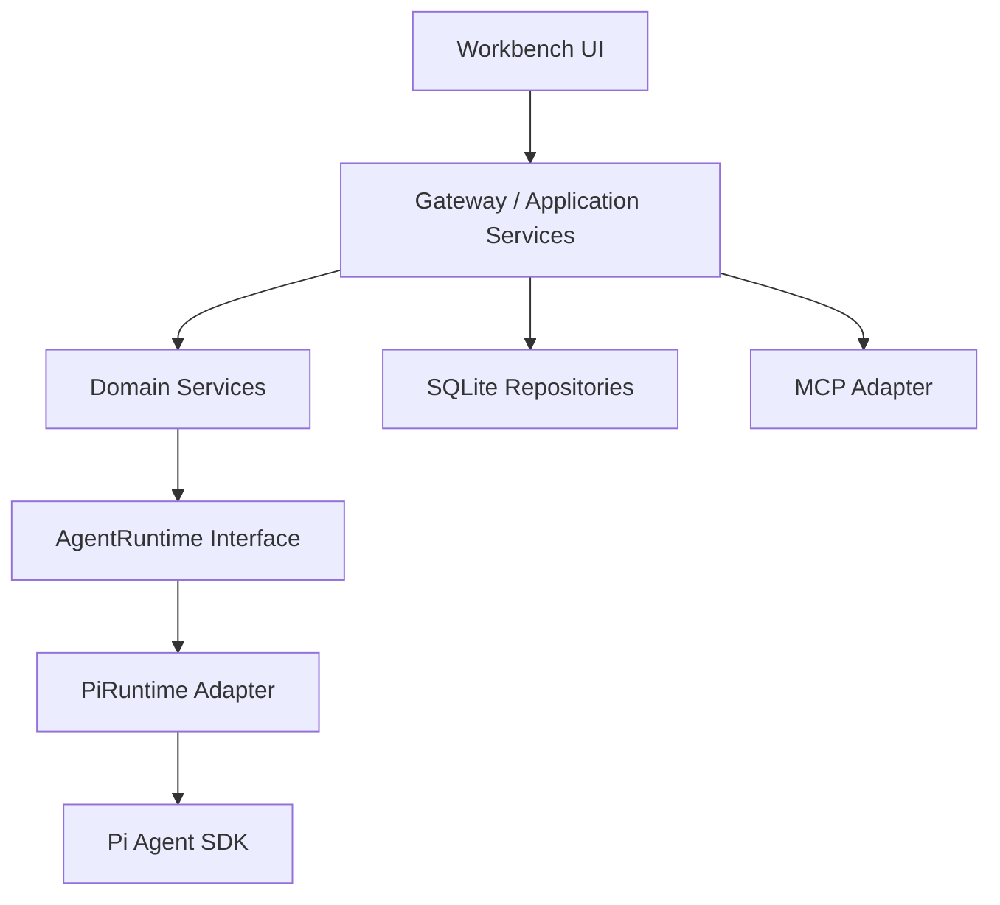

# Personal Workbench

基于 **Pi Agent Runtime** 的本地优先 AI 工作台。在浏览器中选择助手、打开项目文件夹，让 AI 读写文件、运行终端、使用浏览器和桌面工具，并保留项目上下文与对话历史。

**中文界面 · 项目会话 · 四种助手 · 可交互终端 · 上下文压缩 · 执行沙箱**

Pi 负责模型调用、Agent 运行与会话历史；Workbench 提供项目管理、配置、权限、知识检索和网页界面。模型通过你配置的供应商调用；工作台数据默认存储在本机。

[项目说明](#项目说明) · [快速开始](#快速开始) · [助手模式](#助手模式) · [数据与权限](#数据与权限) · [上游资料](#上游资料)

## 项目说明

本项目基于 [Pi Agent Runtime](https://github.com/earendil-works/pi) 改造，是个人维护的本地优先 AI 工作台，仅供学习与研究参考。它不是 Pi 官方项目，也不代表 Pi 项目团队的立场或承诺。本仓库独立存储项目，不向 Pi 上游提交分支或 Pull Request。

根目录 `docs/` 保存项目内部文档和验证材料，按项目要求保留在本地，不发布到此公共仓库。Pi 上游源码及版权声明按仓库中的许可证文件保留。

## 主要功能

| 功能 | 说明 |
| --- | --- |
| 中文工作台 | 首页汇总项目、任务、最近会话和产物，支持亮色与暗色主题 |
| 助手管理 | 内置极简、标准、PTC 和创造助手；支持自定义、复制、归档、恢复和删除 |
| 项目与普通会话 | 打开已有文件夹作为项目；会话按项目分组，可在列表中新建项目和会话；无项目对话有独立工作目录 |
| 对话与命名 | 流式文本、思考和工具结果；根据完整首条请求生成标题，运行中可重命名；支持停止、恢复、归档与删除 |
| 纠偏与排队 | 运行中追加指令，或把后续消息排队；队列支持编辑、删除和提前发送 |
| 模型与登录 | 在添加供应商时使用 Pi 原生登录，或配置自定义 API；复用已有 Pi 凭证，选择模型和思考档位 |
| 上下文与用量 | 展示轮次、步骤、速度、缓存与 Token 用量；悬停查看上下文实际量 / 上限；支持 `/compact` 和默认 80% 自动压缩 |
| 可交互终端 | 长期命令返回终端会话 ID，可续读、输入和关闭；开发服务器不占住整次工具调用 |
| 浏览器与桌面 | 内置 `browser_use`、`computer_use`；按模型视觉能力提供图像，截图在查看后清理 |
| Skills 与 MCP | 通过文件弹窗或公共 Git 仓库导入 `SKILL.md`；MCP 支持 stdio、HTTP、SSE、API Key 与 OAuth |
| 任务与产物 | 将任务交给指定助手执行，查看运行、审核结果和注册文件产物；支持清理已完成任务数据 |
| 长期记忆 | 用户、全局、每日和项目 Memory 以 Markdown 为真源；助手提出候选，由用户接受或拒绝 |
| 项目自我改进 | 任务完成后独立复盘，将事实提为 Memory、流程提为项目 Skill；支持审核、受限自动更新、回滚及下一轮复用 |
| 项目文档 RAG | 上传 PDF、Word、Markdown 和文本；解析、分块、嵌入并存入本地向量索引，项目助手通过 `knowledge_search` 获取带来源的片段 |
| 文件预览 | 工作区文件树、文本编辑与 Markdown 预览；聊天中的文件链接支持 Ctrl＋左键在侧栏预览 |
| 权限与沙箱 | 会话运行中切换批准模式；单独设置只读、工作区可写、网络访问和额外可写目录 |

扫描型 PDF 需要外部 OCR；嵌入和模型调用需要相应服务配置。Knowledge 索引按项目隔离，会话历史继续由 Pi 持久化。

## 助手模式

新对话先选择助手，之后沿用初始选择，空闲时可切换。四种模式的默认配置如下：

| 助手 | 执行方式 | 适合的工作 |
| --- | --- | --- |
| 极简助手 | 仅使用持久 PowerShell 终端，不加载 Skills 或项目记忆 | 简单任务与终端操作 |
| 标准助手 | 直接调用文件、终端、搜索、浏览器和工作台工具 | 日常开发与项目工作 |
| PTC 助手 | 程序化工具调用：用 TypeScript 组织调用并筛选、汇总结果 | 批量处理与多步骤计算 |
| 创造助手 | 查询实际能力目录，创建和修改可持久保存的助手配置 | 构建专用助手 |

工具、Skills 和 MCP 绑定可按助手配置。

## 快速开始

### 运行要求

- **Node.js 22.19 或更新版本**，推荐 Node.js 24；需要 npm。
- Git；从 Git 仓库导入 Skill 时也需要 Git。
- 现代浏览器。
- 至少一个可用的模型供应商配置，才能实际对话。

目前主要在 Windows 上开发与验证，使用 PowerShell、原生文件选择器和 Windows 桌面工具。macOS / Linux 可尝试手动启动，原生交互与命令隔离尚未在本项目中全面验证。

### Windows 启动

```powershell
git clone https://github.com/quanyechaTAT/personal-workbench.git
cd personal-workbench
.\start.bat
```

也可以直接双击根目录的 **start.bat**。首次启动会按锁文件安装依赖、准备 Pi 模型目录并构建项目。源码、构建配置或锁文件变化后，启动脚本会检查并更新相应产物。

启动成功后，打开终端打印的**一次性访问链接**。默认优先使用 `127.0.0.1:4242`，端口被占用或被系统限制时自动选择可用端口。保持终端打开，退出时按 **Ctrl+C**，等待服务清理完成。

```powershell
.\start.bat --check  # 准备依赖和构建，检查环境，不启动服务
.\start.bat --build  # 强制重新构建后启动
.\start.bat --help
```

### 手动启动

在仓库根目录执行：

```sh
npm ci --ignore-scripts
npm run hydrate:model-data
npm run build:offline
npm run workbench:start
```

`build:offline` 使用已有模型数据，不访问供应商刷新目录；首次使用前需要执行 `hydrate:model-data`。

### 配置模型和助手

1. 打开 **设置 → 模型 → 添加供应商**，选择 Pi 自带模型登录，或填写自定义供应商的地址、API 格式、API Key 和模型。
2. 原生供应商按自身支持的方式提供 API Key、浏览器授权或设备码登录。已有 Pi 登录可直接复用；自定义凭证目录通过 `PI_CODING_AGENT_DIR` 指定。
3. 在 **助手** 页面查看四个内置助手，或创建自己的助手，配置模型、Skills 和工具。
4. 从 **对话 → 新聊天** 开始普通会话；有项目时点击会话列表中的 **项目 +**，选择现有文件夹，再选择助手。
5. 发送首条消息后创建持久会话并自动命名。运行中可以重命名、切换权限、追加指令或排队后续消息。

不要将 API Key 填入助手指令、Skill、项目文档或仓库级 `.npmrc`。仓库根目录的 `.npmrc` 只保存共享的非敏感 npm 设置；npm registry 凭证请放在用户级 `~/.npmrc`（Windows 为 `%USERPROFILE%\.npmrc`）或环境变量中。Workbench 的模型与 MCP 凭证保存在服务端，不随配置公开导出。

### 配置项目知识库

嵌入配置来自 **本系统仓库根目录的 `.env`**，供各项目知识库共同使用；创建项目时不要求在项目目录配置 `.env`。

尚未配置时，复制 [.env.example](.env.example) 为 `.env`，填写服务商提供的值：

```dotenv
EMBED_MODEL_NAME=your-embedding-model
EMBED_API_KEY=your-api-key
EMBED_BASE_URL=https://your-service.example/v1
# EMBED_DIMENSIONS=1024
```

`EMBED_BASE_URL` 为兼容 OpenAI Embeddings 协议的 API 根地址；可选的维度参数仅在服务商支持时填写。修改后重启 Workbench。

进入 **项目 → 知识库** 上传 `.pdf`、`.docx`、`.doc`、`.md` 或文本文件。界面显示解析、嵌入、完成或失败状态，支持预览、下载、重试和删除；索引完成后，给项目助手启用 `knowledge_search`，即可结合来源回答问题。

上传的文档片段会发送给配置的嵌入服务；模型执行检索后，命中的片段可能进入模型请求。

## 数据与权限

默认数据目录为 `~/.personal-workbench/`，Windows 对应 `%USERPROFILE%\.personal-workbench`：

```text
.personal-workbench/
├── workspace/           # 全局指令、Markdown Memory、Skills、文件和产物
│   └── chats/           # 无项目对话各自的工作目录
├── state/
│   ├── workbench.db      # 项目、助手、任务、索引和配置元数据
│   ├── pi/sessions/      # Pi 会话历史
│   ├── credentials/      # MCP 等服务端凭证，不属于可共享工作区
│   ├── indexes/
│   ├── cache/
│   └── logs/
└── config/
    └── workbench.json
```

已有项目的实际工作目录为用户选择的文件夹。数据库和 Pi Session 保存引用与历史，不会复制成另一套完整对话存储。关闭程序后使用同一数据目录重新启动，可以继续原有项目和会话。

| 环境变量 | 作用 |
| --- | --- |
| `PERSONAL_WORKBENCH_HOME` | 自定义 Workbench 数据根目录 |
| `PERSONAL_WORKBENCH_PORT` | 指定端口；`0` 表示由系统分配可用端口 |
| `PI_CODING_AGENT_DIR` | 指定已有 Pi 认证与配置目录 |

默认仅监听本机地址，网页使用一次性启动授权和同源校验。批准模式与执行沙箱分别控制两件事：

- **批准模式**：决定操作是否询问用户，提供“请求批准”“帮我批准”“完全访问权限”。运行中修改后影响后续操作，已有批准请求仍需处理。
- **执行沙箱**：决定本地命令、子进程和文件修改可访问哪些资源。默认工作区可写、命令网络访问关闭；可添加额外可写目录，或切换只读、无限制访问。

“完全访问权限”不会解除沙箱；“无限制访问”才关闭命令隔离。命令沙箱复用固定版本的 Codex 原生组件，不要求 Codex 账号登录。Windows 增强隔离首次初始化可能需要管理员确认；受限令牌模式的网络隔离较弱。

浏览器、桌面、搜索和 MCP 使用各自的工具授权，不属于命令沙箱。

备份前停止服务，保存工作区、项目原文件和状态目录。数据根目录建议放在代码仓库外；`.gitignore` 排除本地 `.env`、`.envrc`、`.npmrc.local` 和 `.npmrc.*.local`、Pi / Codex 凭证与历史、数据库、运行数据、依赖缓存、测试报告和构建产物，同时保留 `.env.example` 等配置模板。含凭证的备份不应上传公共仓库。

## 技术栈与目录

- npm workspaces、TypeScript strict、`tsgo`、Biome。
- React、React Router、TanStack Query、esbuild；Node HTTP Gateway 与 SSE。
- `node:sqlite`、版本化 migrations、`sqlite-vec` 向量索引。
- Pi coding-agent SDK、原生 Skills 和 Extensions；官方 MCP SDK。
- PDF.js、Mammoth 和 Word Extractor；Vitest、jsdom、Playwright。



| 目录 | 职责 |
| --- | --- |
| `packages/workbench-core` | 领域服务、助手、项目、任务、Memory、权限和配置 |
| `packages/workbench-runtime` | 与供应商无关的 Runtime、事件、工具与模型契约 |
| `packages/workbench-runtime-pi` | Pi 会话、事件转换、模型适配、Skills 与 Workbench Extension |
| `packages/workbench-database` | SQLite repositories、migrations 和向量索引 |
| `packages/workbench-mcp` | MCP transport、OAuth、工具发现与执行 |
| `packages/workbench-server` | HTTP/SSE、应用装配、文件与文档处理、生命周期 |
| `packages/workbench-ui` | 中文网页工作台及浏览器测试 |
| `packages/agent`、`packages/ai`、`packages/coding-agent` 等 | 保留的 Pi 上游 Runtime 与工具链 |

UI 通过 Gateway 使用领域服务，不直接操作 Pi 或 SQLite。此仓库独立维护 Workbench 改造，不是 Pi 上游仓库的提交分支。

## 开发与测试

```sh
npm run check
npm run build:offline
npm run check:e2e --workspace=@earendil-works/workbench-ui
```

`npm run check` 包括格式、依赖、导入、类型和浏览器构建检查，并可能自动修正格式。针对改动运行对应测试，例如在 `packages/workbench-server` 目录：

```sh
node ../../node_modules/vitest/dist/cli.js --run test/automatic-session-title.test.ts test/session-controls.test.ts
```

浏览器验收在构建后从仓库根目录运行：

```sh
npm run test:e2e --workspace=@earendil-works/workbench-ui
```

浏览器测试默认使用 Microsoft Edge。使用 Chromium 时先运行 `npx playwright install chromium`，并把环境变量 `WORKBENCH_BROWSER_CHANNEL` 设为 `chromium`。集成测试使用独立临时目录和模拟模型响应。

[Workbench Windows 工作流](.github/workflows/workbench-windows.yml) 执行安装、构建、检查、Workbench 测试与浏览器验收。Pi 上游的发布和维护工作流仅在上游仓库运行。

## 上游资料

- [Pi 原始介绍](README.pi.md) · [Pi SDK](packages/coding-agent/docs/sdk.md)

## 来源与许可证

本项目基于 [earendil-works/pi](https://github.com/earendil-works/pi)，保留上游源码、Git 历史与版权声明，使用 [MIT License](LICENSE)。产品功能主要位于 Workbench packages 中，原始 Pi 介绍保存在 [README.pi.md](README.pi.md)。

[README.pi.md](README.pi.md)、[CONTRIBUTING.md](CONTRIBUTING.md) 和 [SECURITY.md](SECURITY.md) 中的 Pi 上游维护政策与联系地址属于原项目；本工作台问题请提交到本仓库，涉及凭证的内容请先脱敏。
